# PII Detection Engine — Submission

## Task 1: System Design

### Scope

Entities now: `PERSON`, `EMAIL`, `PHONE`, `CREDIT_CARD`. Deferred: IBAN, national IDs, `ORG`, `LOCATION` — each needs its own evaluation.

### Architecture

```mermaid
flowchart LR
    IN["Input Text\n+ optional region hint"] --> SEG["Segmenter\nchunk long input, overlap,\ntrack offsets"]
    SEG --> PR["Pattern Recognizers\nregex + checksum\nEMAIL, PHONE, CREDIT_CARD"]
    SEG --> LD["Language Detector\n(per chunk)"]
    LD --> NER["NER Recognizer\nsmall per-language model\nPERSON"]
    REGISTRY[("Recognizer Registry\nplugin per entity type")] -.registers.-> PR
    REGISTRY -.registers.-> NER
    PR --> POL["Detection Profile\nstrict / balanced\nevidence rules"]
    NER --> POL
    POL --> MG["Merge\nexplicit priority/overlap rules\nper entity type + source"]
    MG --> OUT["Output\nresults: type, start, end\n+ response-level scan status"]
```



### Detection strategy

| Layer | Entities | Why |
|---|---|---|
| Pattern (regex + checksum) | `EMAIL`, `PHONE`, `CREDIT_CARD` (Luhn) | Deterministic; `PHONE` defaults to international format, local only with `region` — guessing regions risks false positives; broader coverage is evaluation-gated |
| NER (small per-language model, lazy-loaded) | `PERSON` | Names lack the fixed structure regex needs |

Pattern recognizers are language-independent; language detection only selects the NER model and can fail on short/mixed text — on an unsupported result NER is skipped for that chunk (`partial`); uncertain results run best-effort, also `partial`. Designed languages: English, Spanish, French; POC implements English NER.

### Merging findings

Regex and model scores aren't comparable, so overlaps resolve via **explicit priority rules per entity type + source** (e.g. a checksum-validated `CREDIT_CARD` beats an overlapping NER span), not "highest score wins".

### Output contract

The engine returns findings as `type`, `start`, `end` (half-open `[start, end)` over Unicode code points), plus a **response-level scan status**: `complete`/`partial`/`failed`. `complete` means every recognizer configured for the request finished — not that the text is free of PII. Evidence tiers stay internal, used for merge/profile decisions. Long input is chunked with overlap internally and mapped back to original offsets.

### Detection profiles

Per-product config picks a detection profile plus per-type evidence rules — this controls which findings surface, not what happens to them:
- **Strict** — accepts weaker-evidence findings: fewer misses, more false positives.
- **Balanced** — needs stronger evidence: fewer false alarms, more misses.

Profiles apply evidence rules; the calling service owns the action (block, mask, log, etc.).

### Adapting & maintenance

- Entity type = **recognizer plugin** (`analyze(text, ctx) -> spans`); new entity/language is additive, not a core change.
- Recognizers are independently tested and versioned; a regression suite runs before deploy.
- NER models lazy-load into a memory-budgeted LRU cache (designed, not built in the POC).

### Performance targets

Hard constraints: **≤150MB whole-process** (interpreter, libraries, model, tokenizer, working memory, cache), **1 CPU core**, **≤100ms average** per scan — single-threaded code doesn't stop an inference library from using multiple cores internally, so its thread pool is pinned. The LRU cache is sized to this budget with headroom for inference and swaps. Max input size is an enforced design cap, not a benchmark fact. Task 3 reports latency/memory across input-size buckets and cold load.

### Security & failure handling

- Input is untrusted: the text itself never determines a network address or file path; models load only from predefined local sources.
- Regex runs under a time-bounded engine (or explicit timeout) plus an input-size limit, not just a ReDoS review.
- Logs/metrics default to aggregate counters (latency, errors, per-type counts) — never per-match offsets or evidence.
- On internal failure the engine returns `failed`/`partial`; the calling service decides whether to block.

## Task 2: Implementation

Python 3.12 proof of concept in `src/pii_engine/`. It implements the Task 1 pipeline for four entity types, with **English-only NER** and language-independent pattern recognizers. 470 tests pass (`pytest`), including the evaluation tooling, plus one strict expected-failure test that pins a documented limitation.

### What I built, and why

| Part | Choice | Why |
|---|---|---|
| Output contract | `type`, `start`, `end` (code points) + status `complete`/`partial`/`failed`; no scores | Matches Task 1; the caller owns the action |
| `EMAIL`, `CREDIT_CARD` | `regex` package with timeouts; cards use digit groups → Luhn → brand prefix and length | Deterministic; a Luhn pass alone is a weak signal (~10% of random numbers), so brand-less hits are a lower tier |
| `PHONE` | `phonenumbers` library; international (`+`) by default, local formats only with `region` | +1 MiB memory, 0.4–11 ms; avoids guessing a country from the language |
| `PERSON` | spaCy `en_core_web_sm`, loaded with `exclude=` so only `tok2vec` + `ner` reach memory | `disable=` still loads weights |
| Language check | Function-word heuristic: English / mixed / other / uncertain / no text, decided **per segment** | spaCy already brings the process to ~120 MiB of the 150 MB limit, so I avoided adding a library or model. I did **not** benchmark language-ID libraries; a library may be more accurate |
| Segmenter | 4,000-char segments, ≥200-char overlap, edge-touching spans dropped | Unsegmented, peak memory reached 347 MiB at 100k chars |
| Merge | Evidence rank (checksum > pattern > model > heuristic), then longer span; losers dropped whole, no unions; O(n log n) comparisons, quadratic worst case with a tiny constant (50k findings: 0.4 s) | Regex and model scores are not comparable |
| Profiles | Evidence-based rules, applied **before** overlap resolution | The NER model exposes no probability, so no confidence is invented |

**Profiles.** *Strict* also accepts brand-less Luhn cards, cards with an unusual first group, and digit-suffix phone recovery. *Balanced* (default) drops them. The profiles do not differ on names: balanced originally required two words for a `PERSON`, a guess that one-word hits are mostly non-names. Measured on real informal text (WNUT-17 dev) it cut `PERSON` recall from 35.4% to 7.3% and did not improve precision (38.9% vs 51.9%), so the rule was removed from the default. On well-cased prompts it trades the other way (precision 95.0% vs 91.6%, recall 77.0% vs 81.1%, see Task 3), so its value depends on the text; the mechanism remains as an option and the evaluation still reports its cost.

**Statuses.** `partial` is returned when a recognizer failed or stopped early, a budget ran out, or text was not fully covered: language `other` (NER skipped), `mixed`, or `uncertain` (letters but no language signal, e.g. a bare name). Text with no letters left after removing emails and URLs skips NER and stays `complete`. Short English with no function words (`Order ID 123456`) is therefore `partial`.

### Differences from the Task 1 design

| Task 1 design | Implemented |
|---|---|
| English, Spanish, French NER | **English only.** In a model-only experiment (spaCy plus one model, nothing else) peak process memory was en 127 MiB (133 MB), es 143 MiB (150.2 MB), fr 151 MiB (158.5 MB); two trims (`gc`, dropping lookup tables) changed nothing. Against 150,000,000 bytes, Spanish is already at the limit with nothing else loaded, so there is no room for the rest of the engine for es and fr. Spanish is a possible extension only if whole-engine headroom is measured. |
| Per-language model LRU cache | **Not implemented.** One model means nothing to evict. A fixed allowlist selects the model; no input text chooses a model or path. |
| Confidence scores for thresholds | Evidence tiers instead, because spaCy `sm` gives none. |
| Language detector (library) | A small word-list heuristic (limits below). |

### Build and run

```
conda create -n pii python=3.12 && conda activate pii
pip install -r requirements-tested.txt           # the EXACT versions used for every measurement, incl. the en_core_web_sm 3.8.0 wheel
pip install -e . --no-deps
pytest -ra                                       # expected: 470 passed, 1 xfailed (and no "skipped")

# run pinned to ONE CPU, the exercise's constraint (the measurements were taken this way):
cmd /c start "" /b /wait /affinity 1 python -m pii_engine "Send it to Emily Carter at emily@example.com or +44 20 7946 0958"   # Windows
taskset -c 0 python -m pii_engine "Send it to Emily Carter at emily@example.com or +44 20 7946 0958"                          # Linux (not run here)

python -m pii_engine --file in.txt --region US --profile strict    # unpinned: convenient for trying it out
python bench/final_measure.py                    # measurements below (pins itself to one CPU)
```

**Reproducing the tests.** `requirements-tested.txt` is the environment the measurements used; the looser alternative is `pip install -e ".[dev]"` plus `python -m spacy download en_core_web_sm`, which allows newer versions. I verified the pinned route in a fresh conda environment (Python 3.12.16, install in about a minute): **470 passed, 1 xfailed, 0 skipped**. `-ra` lists skipped tests with their reason, which matters here: the 7 tests that use the real NER model (`tests/test_integration_real_model.py`) skip automatically if the model is missing, as **one** skipped module. Without the model the summary is `463 passed, 1 skipped, 1 xfailed` and `-ra` prints `SKIPPED ... en_core_web_sm is not installed`; only `470 passed, 1 xfailed` means the whole suite ran. The measurements used Python 3.12.14; the evaluation freeze check records the interpreter version, so under another patch version it reports `python changed` (by design; it only affects re-running the held-out guard, which also needs the model installed). Regenerating the evaluation data in that environment (`python -m evaluation.wnut17 fetch`, `… wnut17 build`, `… synthetic build`) gave files byte-identical to the frozen ones.

Output for the first example: `{"status": "complete", "results": [{"type": "PERSON", "start": 11, "end": 23}, {"type": "EMAIL", "start": 27, "end": 44}, {"type": "PHONE", "start": 48, "end": 64}]}`. 

**One core.** The code does not pin the process. The CLI and library set the numeric-library thread counts (`OMP`/`MKL`/`OPENBLAS`/`NUMEXPR_NUM_THREADS`) to 1 only when they are **unset** (`setdefault`), so a value already in the environment (for example `OPENBLAS_NUM_THREADS=8`) is respected and could use more cores. The one-core constraint is therefore met by running under OS CPU affinity, as in the commands above (verified on Windows: the process sees CPU 0 only). The benchmark pins itself (`bench/_env.py`, psutil) and sets the thread counts to 1, so the reported measurements are single-core. macOS has no affinity API; there only the thread counts apply.

### Measured results

Intel Core i7-1255U, Windows 11, Python 3.12.14, spaCy 3.8.18, `en_core_web_sm` 3.8.0, `phonenumbers` 9.0.43. One core (affinity) and one BLAS/OMP thread; whole-process memory. **Frozen code (`315b27c4a574`), three runs** (`bench/results/task2_final_run1–3.txt`). OneDrive sync was paused; background CPU load before each run was 18%, 5% and 26%. Ranges are the min–max of the three run means. Reproduce with `python bench/final_measure.py`.

**Memory units.** All memory figures are **MiB** (1,048,576 bytes), as reported by the operating system's working-set counters; decimal MB are given beside the key ones (older output files label them "MB"; the scripts now print MiB). The exercise says "150 MB" without defining it. I use the conservative reading, **150,000,000 bytes = 143.05 MiB**.

| Memory (whole process) | MiB | decimal MB | vs 150,000,000 bytes |
|---|---|---|---|
| Before the engine (interpreter + imports) | 83.2–83.4 | 87.2–87.5 | |
| After engine load, current | 119.8–120.5 | 125.6–126.4 | within |
| After engine load, peak | 130.9–131.3 | 137.3–137.7 | within |
| Peak after all size and stress rows, including 100,000-char inputs with up to ~20,000 findings | 134.8–135.3 | 141.3–141.9 | within |
| **Peak at the end of the benchmark** (reached during the 2,000 repeated scans) | **139.2–139.7** | **146.0–146.5** | **within by about 3.5–4 MB** |
| 10 phone regions scanned (lazy metadata) | no measurable change | | |
| 2,000 repeated scans | 125.4–136.4 MiB band; drift −3.0 to +6.7 MiB across runs, no monotonic trend | | |

**The margin is thin.** Replica runs of the whole benchmark (`bench/results/memory_diagnostic.txt`) ended at 146.0–148.4 MB, so against 150,000,000 bytes the headroom is about 1.6–4 MB and varies from run to run. It is an estimate for this machine and these inputs, not a guarantee.

**Why my first set of figures was about 5 MiB higher, and what the diagnostic showed.** My first three runs (kept as `task2_superseded_platform_call_run1–3.txt`) reported a 145 MiB (152 MB) peak, about 2 MB *over* the conservative limit. A focused diagnostic (`bench/memory_probe.py`, `bench/probes/platform_cost.py`; output `bench/results/memory_diagnostic.txt`; each condition in a fresh process, measured in bytes) found:
- **The overshoot came from the benchmark script, not the engine.** Its header called `platform.system()`, which on Windows with Python 3.12 queries WMI and adds **5.0 MiB** to the working set (a registry read or `sys.platform` costs 0.0). I had first guessed the extra 4 MiB was the new language-check tables; that was wrong. The call was removed and the three runs above were repeated.
- **No sustained memory growth observed over 8,000 scans:** private memory stays flat (about 121–125 MiB) and the peak plateaus (134.7–135.5 MiB). This supports stability for the scenario tested (repeated scans of 500–5,000-char inputs in one process); it does not prove the absence of a leak under every possible use.
- **My measurement calls between scans do not matter** (peak 135.4 vs 135.5 MiB with and without them).
- **In a fresh process** the engine alone peaks at 135.4–136.0 MiB over repeated scans (141.9–142.6 MB, within the limit by about 7.5 MB). **After heavy inputs** (100,000-char shapes) the repeated scans lift the peak a further 6–8 MiB before it flattens, to 139.7–139.9 MiB. Allocator fragmentation is my guess for that rise; I did not verify it.

| Latency, sparse prose (~1 finding / 400 chars) | chars (= UTF-8 bytes) | mean ms |
|---|---|---|
| | 500 | 5.3–5.9 |
| | 1,000 | 11.4–11.5 |
| | 2,000 | 19.6–22.1 |
| | 5,000 | 50.0–51.3 |
| | 10,000 | 91.2–94.6 |
| | 100,000 (capacity cap) | 889–952 |

- **Typical vs maximum.** The exercise defines no typical input. I **assumed** a mix of 500 chars 40%, 1,000 25%, 2,000 20%, 5,000 10%, 10,000 5%: weighted mean **18.6–19.3 ms**, against the 100 ms target. The 100 ms average holds up to about 10,000 characters of this text (91–95 ms there). At 100,000 characters (the configurable cap) one scan takes about 0.9 s: that is a capacity limit, not a response-time promise.
- **Other cases.** PII-dense text costs about the same (5,000 chars: 40–49 ms). Non-English text skips NER: Spanish 5,200 B 2.7–2.8 ms; Hebrew 5,000 chars = 8,800 B 1.7 ms. 100,000-char inputs through the whole engine: junk digits 0.47–0.48 s (`complete`), `+` chains 0.68–0.70 s (`partial`), `@`-signs and unbroken letters about 0.11 s (`partial`: language uncertain), and **dense valid findings** (the case junk inputs missed: the first quadratic merge took 12.7 s for 14,285 emails) 14,285 emails 0.07–0.09 s, 5,000 cards 0.42–0.45 s, 5,882 phone numbers 0.36–0.37 s, all `complete` with every finding returned.
- **Cold start.** Model load took 0.32–0.34 s; earlier runs took 1.7–3.5 s (probably a cold file cache, not confirmed), so load before serving traffic.
- **Noise.** Run-to-run means differ by up to ~12% (2,000 chars: 19.6–22.1 ms); single scans spike to about twice the mean (a 46 ms worst scan at 2,000 chars). Numbers are indicative, not exact.

### Security and privacy

- Input is untrusted: no dynamic code execution; text never selects a model, path or address; the CLI reports only an exception class on file errors and never echoes input.
- Regexes have timeouts and bounded, linear patterns. Input over `max_chars` (default 100,000) is **rejected** (`failed`), never truncated, and the CLI reads with the engine's own limit.
- Metrics hold counts and latencies only; there is no API that accepts text, offsets or evidence. Failures record the exception class, never its message.
- One recognizer's failure is isolated; the engine never raises on bad input and the caller decides whether to block on `partial`/`failed`.

### Defects found by testing and review (and fixed)

- **Phone evasion.** A real number hidden by junk digits *before* it (exhausting the matcher's try budget) or *after* it (`+44 20 7946 0958 12`). Now: 1,000-char windows with their own budgets, strict-only prefix recovery, and every exhausted budget reported as `partial`. Recovery originally re-parsed every accepted number, so a document of valid numbers came back `partial`; it now skips candidates the matcher accepted.
- **Card dropped by a digit suffix.** The recognizer chose the longest valid run even when a shorter run had stronger evidence, so `378282246310005 101` returned nothing under the balanced profile. It now emits every valid run and leaves the choice to the profile filter and merge. (Brands with several valid lengths may report the longer run: a larger span, not a miss.)
- **Card hidden by digits before it.** `1 2 3 4 5 6 4111 1111 1111 1111` and `ref 12-34-56-78-90 4111 …` returned nothing: the regex split digit groups into chains of 8 without overlap, so the card straddled two chains. A first fix (overlapping windows) still lost it about 10% of the time, because a window such as `4 5 6 7 3782 8224 6310` can pass Luhn with a known brand by chance, is longer, and so won the merge tie and left the real card's last digits unreported. Windows now start at every digit group, and a window whose first group has fewer than 4 digits gets the lowest evidence, so the real card wins. That rests on an assumption that real cards start with a group of at least four digits: a heuristic, not a universal rule. Recognition runs over digit groups in one pass (no regex per chain), with its own deadline check.
- **Unicode digits.** The regex accepted any digit but the checksum assumed ASCII, so fullwidth digits got weaker evidence (dropped by balanced) and Arabic-Indic digits were not detected. Digits are now normalised for the checksum, keeping original offsets.
- **Quadratic merge.** Each finding was compared with all accepted ones: 14,285 valid emails took 12.7 s. Now O(n log n) comparisons with a binary search (0.09 s); inserting into the sorted list can still be quadratic in the worst case (50k findings: 0.4 s). Checked against the original algorithm on 300 random inputs. My earlier "bounded to ~1.2 s" claim came from testing only junk input.
- **Timeouts lost findings.** A regex timeout discarded everything a recognizer had found, and a fixed 50 ms budget was too tight for 100,000 chars of dense valid input, so results depended on machine load. Recognizers now keep their findings (`partial`) and the budget scales with length (50 ms per 10,000 chars).
- **Language check.** Email addresses voted as words (`.com` counted as Portuguese) and their letters diluted Hebrew text. A first fix removed the whole space-free token, so `Alice<alice@example.com>` became "no text" and `李伟<email@example.com>` was `complete`; only the address is removed now. A word-list bug also made long Spanish text look mixed (found from a skip counter in a measurement run).
- **Measurement overhead.** The benchmark's header called `platform.system()`, which on Windows with Python 3.12 adds 5.0 MiB to the working set, so my first memory figures were about 5 MiB too high and showed a peak about 2 MB over the conservative limit. Found by a focused diagnostic after review, fixed in the script, and the runs were repeated; the engine was unchanged. I had first blamed the language-check tables, which was wrong.
- **CLI.** It read with its own copy of the size limit, so an engine with a larger limit would have received a silently truncated prefix; it now reads with the engine's limit.

### Limitations

- **Languages.** NER is English only; non-English text is `partial` with patterns only. A bare non-English name without function words is `uncertain` and gets a best-effort English-model pass.
- **Language check.** A word-list heuristic over en/es/fr/de/it/pt function words: other Latin-script languages are likely `uncertain`, and mixed text is handled per segment, not per language inside a segment.
- **Phones.** Local formats need `region`; local numbers followed by digits can be missed; prefix-recovered international numbers are strict-only because on random `+` digit chains they add about 4× the matcher's false hits. Completeness detection reads a private `phonenumbers` attribute (version pinned, behaviour tested, fails safe).
- **Cards.** Only single-space or hyphen separators; a card glued to other digits is not matched. Any Unicode decimal digit is accepted. A card may span **at most 8 digit groups**, so one written a digit per group (`4 1 1 1 … `, 16 groups) is missed in every profile; two digits per group (8 groups) is found in strict only. A card written with a first group of fewer than 4 digits is strict-only, by the heuristic described above. A digit run holding two overlapping valid cards whose first group is a full 4 digits is genuinely ambiguous: one is chosen and the other's last digits can go unreported (`4008 4111 1111 1111 1111` reports only the first 16 digits, so the intended card in groups 2–5 is not fully covered; pinned as a strict expected-failure test on that card).
- **Segment edges.** Spans of 200+ chars can be lost at an edge; the guarantee for NER is empirical (a 258-position real-model sweep found the name whole once each time), not a proof.
- **One core is not enforced by the code.** Thread counts default to 1 only if unset, and nothing pins the process (see "One core" above). The CLI's own docstring still shows the shorter `start /affinity 1 …` form; it was not edited because the engine source is frozen.
- **Memory margin.** The whole-benchmark peak is 146.0–146.5 MB against 150,000,000 bytes: a margin of about 1.6–4 MB, which varies by run (replica runs ended at 146.0–148.4 MB). After heavy inputs the peak rises a little during later scans (cause not verified). A different machine, Python or spaCy build could change it.
- **Latency.** Linear in length (~9–11 ms per 1,000 chars on this laptop at low background load); input at the 100,000-char cap costs about 0.1–1.0 s depending on content (measured on the shapes listed above). A caller-side deadline is still advisable. Latency worst cases were searched with junk and dense-valid inputs only; other adversarial shapes may exist.
- **Portability.** Library and CLI are plain Python. The bench scripts have Linux/macOS fallbacks for peak memory, CPU model and pinning (`bench/_env.py`) that I have **not run** on those systems; all reported numbers are from Windows. `bench/results/`: `task2_final_run1–3.txt` are the final runs on the frozen code and the source of every number above; `memory_diagnostic.txt` is the memory diagnostic. Kept as history: `task2_superseded_platform_call_run1–3.txt` (the first final runs, with the 5 MiB measurement overhead; their "MB" labels mean MiB), `task2_run2.txt` and `task2_run3.txt` (earlier runs, before the final fixes), `task2_stress_loaded.txt` (post-fix stress rows under heavy load) and `task2_loaded_before_timeout_fix.txt` (the loaded run that exposed the timeout bug: `valid-mail` returned 0 findings, `partial`). The Task 3 evaluation reports are in `evaluation/results/` and `evaluation/prompts/results/`.
- **Not covered.** `ORG`, `LOCATION`, IBAN and national IDs (deferred in Task 1). Detection-quality results, including the weak ones, are in Task 3.

## Task 3: Performance Evaluation

**Method.** The engine was frozen (`315b27c4a574`) before any held-out data was scored, and each held-out set was run once and logged. Three evidence sets, deliberately different: **(a) well-cased prompts**: 188 AI-authored prompts from two assistant interactions, 30 of them supplied by the project owner (126 with names, 62 without; 148 names; two names shared, so the parts are not independent). A purposive sample, easier than real traffic (mostly full names, chosen name ratio). **(b) Synthetic held-out formats**: 432 records whose templates and formats are disjoint from dev (also covers email, phone, cards). **(c) WNUT-17**: real informal text, 400 sentences; overlap with the model's training data cannot be ruled out. Metrics: exact precision and recall, coverage recall, 95% bootstrap intervals (details: `evaluation/README.md`).

**Results, `balanced` default: precision / recall %**

| Set | PERSON | EMAIL | PHONE | CARD |
|---|---|---|---|---|
| Well-cased prompts (AI-authored) | 91.6 [86–96] / 81.1 [75–87] | 100 / 100 (n=2) | 100 / 100 (n=3) | 100 / 100 (n=1) |
| Synthetic, held-out formats | 31.4 [19–45] / 12.5 [7–18] | 100 / 100 | 96.4 / 77.3 | 100 / 76.9 |
| WNUT-17, informal text | 35.6 [27–45] / 29.9 [22–38] | not labelled | not labelled | not labelled |

**What it shows**
- **Name quality varied substantially across data sets:** F1 86 on the AI-authored, well-cased prompt sample, 33 on WNUT-17 informal text. The sets also differ in name length, phrasing, context and construction, so casing is not shown to be the cause. Real traffic is a mix; no single number is "the" accuracy.
- **Prompt errors:** of 148 names, 120 matched exactly, 22 were not found, 2 were found only in part and 4 inside an oversized span (sentence-initial imperatives swallowed into the name, `Add Marta Kowalczyk`). Misses are often hyphenated or non-Western names; false alarms include `Pad Thai` and `Landlord`.
- **Held-out formats** drop to 12.5% recall; templated dev data had overstated it (100 / 48).
- **Patterns are the strength.** Phone and card misses are design choices (no region, unknown card brands). `strict` recovers them but flags all 24 Luhn-valid order numbers as cards.
- **Two-word-name rule** (removed): cost 28 recall points on informal text, but traded 3 precision for 4 recall on prompts.
- **`partial`**: 3 of 188 cased prompts, but 67% of telegraphic synthetic records and 19% of WNUT sentences.

**Technical performance** (frozen code, i7-1255U, one core, three runs). Memory, MiB: 131 peak after load; 139–140 at the worst point of the benchmark, 146 MB, inside the 150,000,000-byte limit (143 MiB) by about 3.5 MB, a thin margin. Latency: 5–6 ms at 500 characters, 11 at 1,000, 50–51 at 5,000, 91–95 at 10,000; weighted mean under my assumed request mix 19 ms (target 100).

**Next priorities.** (1) A stronger name model inside the budget: a quantized DistilBERT lifted WNUT dev F1 from 42 to 56 but peaked near 154 MiB (about 161 MB) and took 77 ms per 1,000 characters; fine-tuning raised precision, not recall (`bench/probes`). (2) Separate "language uncertain" from real coverage gaps. (3) Card context rules to cut Luhn-valid ID false alarms.
